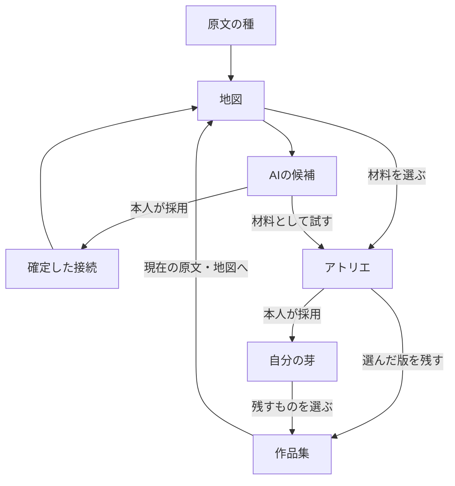

# Kizashi Plus — 地図・AIの提案・アトリエ・作品集

更新日: 2026-11-27（日本時間）

状態: **ユーザーの方針を具体化した設計。追加機能は未実装・未検証。**

調査基準: `main` / `aef86a3433c3b1b5dae266c7419ae7083099b7f9`

## 1. まず伝えたいこと

**Plusを開くと、自分の考えが見渡しやすくなり、気になるところを深く扱える。**

有料価値の中心は、地図の品質・見やすさ・使いやすさを大きく上げること。AIは見落としていた関係を理由とともに差し出し、本人が選ぶ。選んだ材料はアトリエで育て、残したいものだけ作品集へ入れる。AIを使わない日にも、地図・アトリエ・作品集が価値を持つ。

| 場所 | 使う人の目的 | Plusで増える価値 |
|---|---|---|
| 地図 | 自分の考えを眺め、見たいものへたどる | 全体と周囲の切替、安定した配置、整理・焦点・保存した見方 |
| AIの提案 | 自分では見えなかった関係に気づく | 原文を根拠にした少数の候補、理由、採用・見送り |
| アトリエ | 材料を眺めながら自分の言葉を育てる | 複数の下書き・版比較・好きな一節の固定・由来への往復 |
| 作品集 | 気に入った言葉や地図を美しく残す | 自分で選んだ内容の組版、並べ替え、画像・PDF、由来 |

全部を順に使うことを要求しない。メモを一つ残すだけでも、地図を眺めるだけでも、一回の利用は完了する。

## 2. この文書群の読み方

| 文書 | 内容 |
|---|---|
| 本書 | 方針、無料と有料の境界、初回販売範囲、現行との違い |
| [地図の設計](plus-map-design.md) | 視覚表現、画面状態、移動・選択・整理、規模別表示、可読性 |
| [アトリエ・作品集](plus-atelier-collection-design.md) | 材料、下書き、版、芽への採用、作品の編集・出力 |
| [AI・データ契約](plus-ai-data-contracts.md) | 提案と接続の分離、同意、データモデル、保存・移行・削除 |
| [課金と品質検証](plus-commerce-validation.md) | 購入状態、利用権、試用・価格の判断事項、受入試験 |
| [実装計画](plus-implementation-plan.md) | Phase 11.0〜11.6、依存関係、対象ファイル、完了条件、記録表 |

無料コアの正本は引き続き [Core Growth Loop](core-growth-loop.md) / [UX](core-growth-ux.md) / [Data](core-growth-data.md) / [Plan](core-growth-plan.md)。実装・検証の事実は [Progress](core-growth-progress.md) / [Verification](core-growth-verification.md) に記録する。Plusの提案を、これらの実装結果と読み替えない。

### 既存設計との優先関係

今回のユーザー指示により、旧 [Product Quality & Subscription Blueprint](product-quality-subscription-blueprint.md) の有料機能の優先順位を更新する。

- Plusの主役を、同期・長期便り中心から、上質な地図と創作の往復へ具体化する。
- 旧blueprintのPhase 11〜13の順序は、[本計画のPhase 11.0〜11.6](plus-implementation-plan.md)に置き換える。先に課金画面だけを作る根拠にしない。
- 旧「同期・長期便り・Studioのうち二つ」の販売条件は、本書§8と課金文書の受入条件に置き換える。同期を初回Plusの必須にしない。
- 旧価格、年額、7日試用は仮説の記録として残す。販売条件を確定した記録にはしない。
- 無料コアの保存・接続・芽・全件探索・データ権利は保持する。原文や芽を有料データへ移し替えない。
- MVPの「外部AI・課金を初期に入れない」は無料中核の範囲を示す。今回の後続Plus設計とは両立し、今回のdocs追加で実装や販売を開始しない。

## 3. コードを確認した現在地

| 対象 | 基準コミットで確認したこと | Plusで追加する設計 |
|---|---|---|
| [LocalMap](../src/components/LocalMap.tsx) / [mapLayout](../src/utils/mapLayout.ts) | 中心と直接つながる種を表示。表示上限と等価リストがある | 全体図、まとまり、焦点、保存した見方、配置編集 |
| [ConnectionsPanel](../src/components/ConnectionsPanel.tsx) / [links](../src/utils/links.ts) | 共通語・カテゴリからローカル候補。本人の操作で接続 | 文脈を使う外部AIの候補と、明示的な同意・理由確認 |
| [SynthesisScreen](../src/screens/SynthesisScreen.tsx) | 材料を選び、原文と別に自分の芽を書く | 独立した制作スペース、複数の版、比較、固定した一節 |
| [types](../src/domain/types.ts) | `SeedConnection`が接続の正本。`Seed.synthesis`は現在の芽一つ | `MapView` / `AtelierProject` / `AtelierRevision` / `CollectionItem` 等 |
| [gardenStorage](../src/data/gardenStorage.ts) / [gardenWriter](../src/data/gardenWriter.ts) | v2保存・旧形式の移行・直列書込み・失敗時保護 | Plusの保存を同じ整合性契約へ統合。v3移行は後続実装 |
| [aiAssist](../src/domain/aiAssist.ts) | `LocalOnlyAiAssistService`。外部AI接続なし | 利用者の操作、送信範囲、利用権を検証するAIサービス |
| [package.json](../package.json) / [README](../README.md) | 課金SDK、認証、クラウド同期の完成実装はない | 必要性とExpo互換性を検証してから依存・サーバーを選ぶ |

Phase 10.1〜10.5は実装記録があり、10.6は公開判定保留。既存のWeb/Node結果は実iPhoneの合格を意味しない。Plusの実機速度・AI精度・購入・作品の出力品質は、今回の設計作業では未検証。

## 4. 体験をつなぐ契約

アトリエの選んだ版から作品集へ直接進める。芽への昇格を作品保存の前提にしない。作品を開いたときは選んだ固定版を表示し、「作ったときの材料を見る」と「現在の原文を開く」を区別する。原文や現在の地図を見たあとも、開いていた同じ `CollectionRevision` へ戻り、最新の作品版へ自動で切り替えない。

### 混同しないもの

1. **近くに配置されたこと**は、本人がつないだ関係ではない。まとまりの候補を採用しても、`SeedConnection`を増やさない。
2. **AI候補を読むこと**は、候補の採用ではない。点線の候補は独立して保持する。
3. **材料として持ち込むこと**は、接続の採用ではない。未接続の二つでも考えられる。
4. **下書きを残すこと**は、芽への昇格ではない。芽にする件数・日数・AI評価の条件を作らない。
5. **芽にすること**は、作品集への掲載ではない。原文は別に保ち、作品集は本人が選ぶ。
6. **作品集に入れること**は、公開・共有ではない。初期状態は本人だけが見る端末内の記録。

地図・詳細・アトリエ・作品集を往復するときは、選択中の種、表示範囲、検索、拡大率、位置、見ている作品版を文脈として引き継ぐ。画面を開いただけで原文・採用・課金・外部送信を変更しない。地図はまず固定集合／条件表示の対象を決め、その集合内の実接続から周辺とまとまりを表示する。範囲外を開くときは一時表示とし、保存した範囲を変更しない。

## 5. 無料と有料の境界

| 体験 | 無料で保つもの | Plusで加えるもの |
|---|---|---|
| 書く・探す | ローカルの作成・編集・全件検索・任意カテゴリ | 保存数や検索対象を減らして課金を促さない |
| つなぐ | 手動接続、接続解除、ローカルの説明可能な候補 | 意味や目的を手がかりにしたAI候補、候補の比較 |
| 地図 | 基本の周辺図・等価リスト・全文・基本の移動 | 多数のまとまり、視点保存、安定した全体配置、整理操作 |
| 芽 | 本人が選んだ材料から自分の芽を残す | アトリエの制作スペース・版比較・固定した一節・短い案 |
| 残す | JSON/テキストで原文・関係・芽を取り出す | 作品集の新規作成、地図と文章の組版、画像/PDF |
| 読みやすさ | 文字切れ・誤表示・操作不能の修正、文字拡大・読み上げ | 広い範囲を扱う表示・整理・往復の上質さ |
| プライバシー | 削除・送信禁止・同意撤回・データの持出し | 購入によって権利を変えない |

Plus失効後も、既存の地図の見方・原文・芽・アトリエの自分の文章・作品集は保持し、閲覧・基本編集・標準の書出しを可能にする。既存作品は、保存済みの形式・テンプレート・配置設定の範囲で、手動編集後の文章をPNG/PDFへ再出力できる。新しい高機能な見方の保存、版比較等の有料処理、新規の作品構成・形式・テンプレート適用、AIリクエストの可否は [利用権表](plus-commerce-validation.md)を正本とする。保存済みの地図を初期配置へ戻さない。クラウドの無期限保存は約束しない。

## 6. 初回Plusとして仕上げる範囲

### 初回販売の必須範囲

- **地図:** 全体/選んだ種の周囲、まとまりの開閉、情報量に応じた拡大表示、配置の保持・固定、整理のプレビューと取消、保存した見方、検索・リストとの往復。
- **AI:** 原文と理由を伴う個別候補、点線/実線の区別、見送り・復元、古い候補の無効化、送信範囲の選択、送信禁止、失敗時の元データ保持。
- **アトリエ:** 原文の材料棚、独立下書き、複数の版と比較、固定した一節、本人の操作で受け取る短い提案、既存の芽への明示的な採用・見直し。
- **作品集:** ことばのカード、地図と文章の1ページ。選択・並べ替え・見え方・プレビュー・画像/PDF出力・由来への戻り。
- **商品としての完成:** 利用権の全状態、明確な購入条件、復元、失効後のアクセス、オフラインでのコア、実機・初見ユーザー・データ保護の検証。

機能は任意に使える。購入のためにAI同意を必須にしない。AIを無効にしても地図・アトリエ・作品集を使える。

### 設計を残し、後続へ送るもの

小冊子の複数ページ組版、長期の時間軸、音声・画像入力、ウィジェット、同期、共同編集は別の追加計画とする。初回販売で提供していないものをPlusの購入画面に含めない。小冊子の目的と編集原則は作品集設計へ記録し、ページ分割・大容量・出力の試験が済んでから追加する。

AIの長文代筆、自動接続、自動昇格、性格や心理状態の判定、公開フィード、ランキング、継続日数による解禁、ストア規則の回避を導入しない。

## 7. 日常の画面を静かに保つ

- 書く・読む画面は現行コアの入口を保つ。制作機能の説明カードを常時並べない。
- 地図で種を選んだときに「アトリエへ」、アトリエで残す版を選んだときに「作品集へ」が選べる。芽の詳細からも作品集へ進めるが、芽にすることは作品保存の条件にしない。
- 「つながりを探す」を本人が押したときにAIを使う。常時全件走査や起動時の一括送信はしない。
- アトリエを途中で離れても下書きを残す。未使用の機能や完成していない作品を督促しない。
- Plusの入口は本人が高度な見方等を開いたときと設定内。書いている最中、保存直後、復旧・削除・書出し中に購入画面を差し込まない。
- 自分のメモを使う地図プレビューはローカルで実行し、外部AIへの同意と混同しない。例のデータには例と表示する。

## 8. 販売してよい品質の判断

地図単体で「見渡しやすい・読みやすい・戻りやすい」という変化を確認し、そのうえでアトリエと作品集まで一周できることを確かめる。

| 判断 | 確かめること |
|---|---|
| 地図の品質 | 同じメモ群を使い、欲しい種を探す・関係を読む・元の場所へ戻る操作が迷わずできる |
| AIの価値 | 理由の根拠が実際の原文にあり、似た語の一致だけに偏らず、本人が使える関係を提案できる |
| 本人の主導権 | 候補・材料・下書き・芽・作品集・共有を別々に選べると理解される |
| 創作の深さ | 途中の案を残し、比較して、以前の案にも戻れる。AIなしでも成立する |
| 作品の品質 | 実機プレビューと出力の文字・余白・線・改ページが読め、選んでいない私的内容が出ない |
| 信頼 | 保存失敗・通信断・購入失効・同意撤回・削除後も、文章と権利を契約どおり扱う |
| 継続対価 | 継続して使う価値と運用原価を確認し、販売方式・価格・利用枠を決定する |

購入率、AI採用率、メモ件数の一つだけで合格にしない。小人数の初見観察は問題の発見に使い、市場全体の有料需要の証明にはしない。数値目標・方法・未実施欄は [課金と品質検証](plus-commerce-validation.md)にまとめる。

地図の有料品質差は、[地図設計§7.1](plus-map-design.md#71-plusの品質差を確かめる比較)の3課題で確認する。同じ知りたいこと・材料・戻り先を、無料では既存の局所図／一覧／検索、Plusでは追加の地図操作で達成する比較とし、存在しない同一操作を無料へ要求しない。同じ端末・同じデータまたは条件を揃えたfixtureを使い、試用順を入れ替える。操作数・戻り失敗・読み違いと、本人の便利さの説明を合わせ、無料コアを維持したうえで複数課題の改善を確認する。数値の合格線は未検証の仮説として観察前に固定し、実施記録なしで品質差を確定しない。

## 9. 未確定事項の扱い

単一のPlusにまとめる方針を採用する。月額¥680・年額¥5,800・7日試用は以前の価格仮説であり、今回確定していない。販売期間、試用方式、AI利用枠、提供モデル、課金SDK、実機の対象範囲は実装検証の記録をもとに決める。

未確定の外部条件があっても、ローカル地図、保存契約、アトリエ、作品集、購入状態の偽物を使う開発用検証は進められる。検証用の状態を本番の有料権利やAI精度の実績として見せない。具体的な実装順と販売前に確定が必要な条件は [実装計画](plus-implementation-plan.md)に従う。
